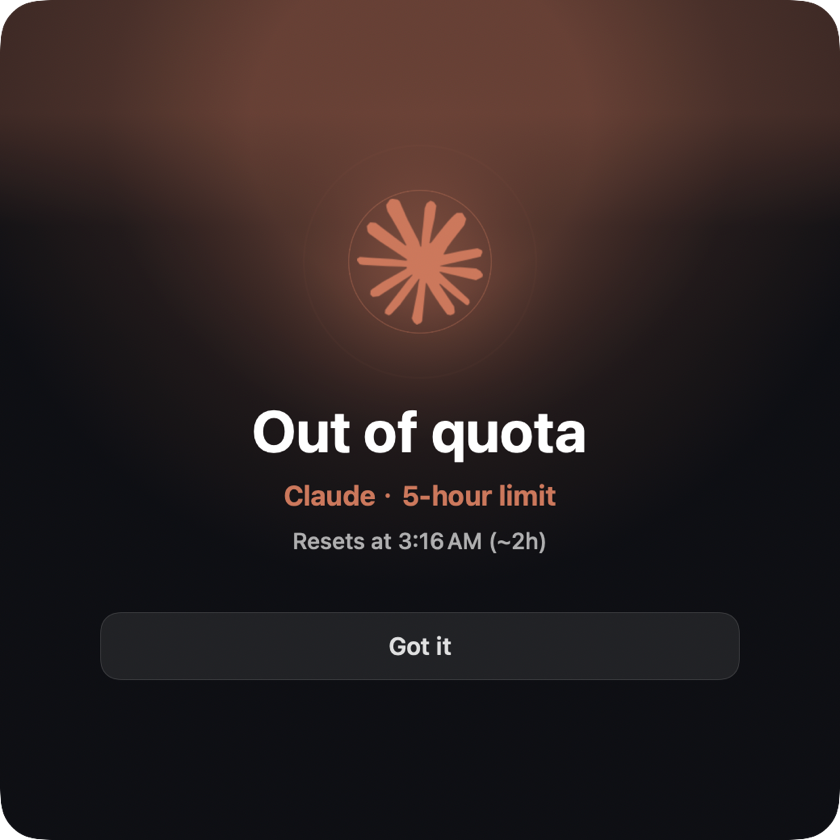
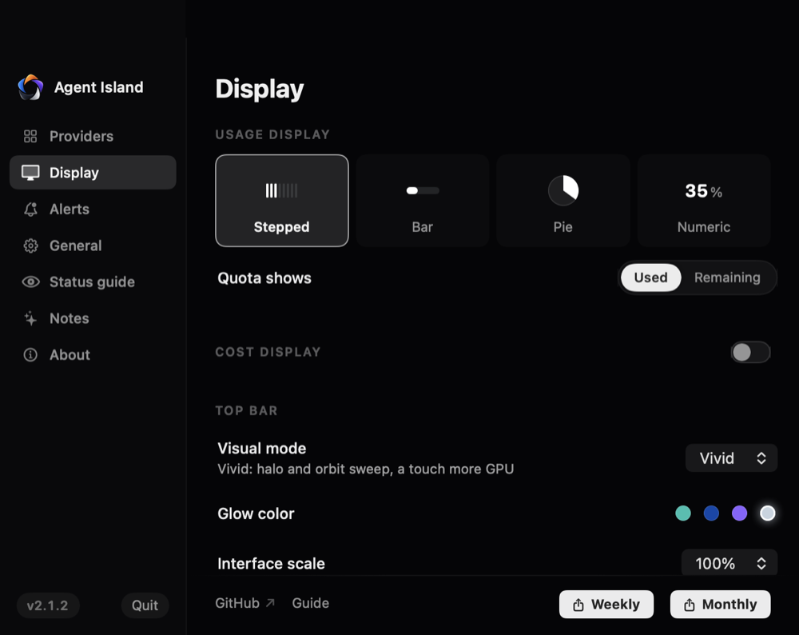
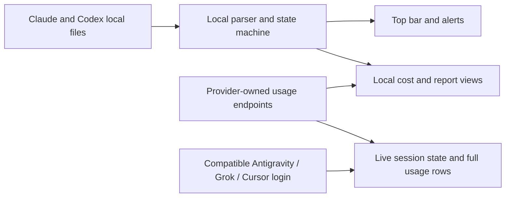

<div align="center">


# Agent Island

**A status companion for your AI coding agents — Claude Code, Codex, Antigravity, Grok, and Cursor.**

See what every run is doing. Step away, and Agent Island calls you back when it is your turn. Local-first, no Agent Island account, no product telemetry.

**[agent-island.dev](https://agent-island.dev)** · [简体中文](README.zh-CN.md)

[](https://github.com/tristan666666/agent-island/releases/latest)
[](https://github.com/tristan666666/agent-island/releases)
[](#macos-and-windows)
[](https://github.com/tristan666666/agent-island/actions)
[](LICENSE)

[](https://github.com/jaywcjlove/awesome-mac/blob/master/README.md#menu-bar-tools)
[](https://github.com/1c7/chinese-independent-developer#readme)
[](https://github.com/Axorax/awesome-free-apps#developer-tools)
[](https://github.com/alvinreal/awesome-opensource-ai#ai-native-ides--development-environments)
[](https://github.com/guanguans/favorite-link#readme)
[](https://github.com/jeffreyjackson/mac-apps#for-developers)
[](https://github.com/jaywcjlove/awesome-swift-macos-apps/blob/main/README.md#ai)
[](https://github.com/marcelscruz/dev-resources#open-source)
[](https://github.com/bradAGI/awesome-cli-coding-agents#agent-infrastructure)
[](https://github.com/eltociear/awesome-AI-driven-development#code-analysis--search)
[](https://github.com/ARUNAGIRINATHAN-K/awesome-ai-agents-2026#agent-tooling-and-infrastructure)
[](https://github.com/JSONbored/awesome-claude#readme)

<a href="https://www.producthunt.com/products/agent-island-2?embed=true&utm_source=badge-featured&utm_medium=badge&utm_campaign=badge-agent-island-2">
  
</a>

<!-- The 1.7.1 launch film was pulled here — it predates the five-provider
     island and the current brand. Drop the new demo loop (running -> your
     turn -> open session) in this slot once it is shot. -->

<p>
  <a href="#quick-start"><strong>Quick Start</strong></a> ·
  <a href="https://github.com/tristan666666/agent-island/releases/latest">Download</a> ·
  <a href="https://agent-island.dev">Website</a> ·
  <a href="docs/how-agent-island-detects-session-state.md">How it works</a> ·
  <a href="CONTRIBUTING.md">Contribute</a>
</p>

</div>

## Quick Start

| Platform | Download | Requirement |
|---|---|---|
| macOS | [AgentIsland-2.1.2.dmg](https://github.com/tristan666666/agent-island/releases/download/v2.1.2/AgentIsland-2.1.2.dmg) | macOS 13+ |
| Windows | [AgentIsland-2.1.2-win-x64.zip](https://github.com/tristan666666/agent-island/releases/download/v2.1.2/AgentIsland-2.1.2-win-x64.zip) | Windows 10/11 x64 |

**macOS** — drag into Applications. On first launch, right-click the app and choose **Open** ([why?](#faq)).

**Windows** — unzip and run `AgentIsland.WinUI.exe`.

<details>
<summary>Package managers and source builds</summary>

Homebrew, WinGet, and Scoop may lag behind the latest GitHub release. Check the version they offer before installing.

```sh
brew install tristan666666/tap/agentisland
```

```powershell
winget install TristanTang.AgentIsland
```

```powershell
scoop bucket add agent-island https://github.com/tristan666666/scoop-bucket
scoop install agent-island/agentisland
```

Build the macOS app from source:

```sh
git clone https://github.com/tristan666666/agent-island.git
cd agent-island
./scripts/verify.sh
open build/AgentIsland.app
```

Windows build and test instructions are tracked in [issue #10](https://github.com/tristan666666/agent-island/issues/10).

</details>

## Table of Contents

- [Features](#features)
  - [Status monitoring](#status-monitoring)
  - [Usage](#usage)
  - [Weekly & monthly report cards](#weekly--monthly-report-cards)
  - [It's-your-turn clock](#its-your-turn-clock)
  - [Personalization](#personalization)
  - [macOS and Windows](#macos-and-windows)
- [Community](#community)
- [How it works](#how-it-works)
- [Why Agent Island](#why-agent-island)
- [Privacy and safety](#privacy-and-safety)
- [FAQ](#faq)
- [Contributing](#contributing)
- [Roadmap and releases](#roadmap-and-releases)
- [License](#license)

## Features

### Status monitoring

Live session activity from all five agents in one compact top bar — read the state without pulling any session to the foreground:


| Cue | Meaning |
|---|---|
| Logo rotates | A session is working |
| Logo is still | No session is currently working |
| Logo pulses red | A session needs attention because of a provider, login, network, or rate-limit error |

### Usage

Pick any two of the five for the island's slots. Live session state covers all five; each selected provider keeps a full usage row with breakdowns on hover. A provider with no local sign-in gets no slot and no row.

Cost, calendar, and report summaries are calculated locally from session records. Provider quota and reset data comes from provider-owned endpoints through the local credential store.

Codex machines with more than one account can park each login under a name and switch from the provider menu — with an opt-in auto-switch that rotates to the next parked account when the active quota reads exhausted, driven by real usage numbers.


Machines with a single subscription get the solo layout automatically — the provider's mark and name hold one half of the panel, the live windows the other:


### Weekly & monthly report cards

Shareable cards rendered locally: total tokens with an ≈ API value line (an estimate from a local price table, not a bill), a faction duel whose clash sits exactly at your usage split, 7-day bars, and a model donut closing on the top three. Both cards page back through past weeks and months, and accept any start date from a calendar picker. Copying or saving a card is an explicit user action; Agent Island does not publish it for you.

<table>
  <tr>
    <td align="center"><br><sub>English · Claude wins the week</sub></td>
    <td align="center"><br><sub>简体中文 · Claude wins the month</sub></td>
  </tr>
</table>

### It's-your-turn clock

When a background turn finishes, Agent Island opens an alarm window, sends a notification, and plays a sound. Completed turns queue rather than overwrite each other. If you are already in that session's terminal, the alarm holds and fires the moment you switch away with the turn still open.

<table>
  <tr>
    <td align="center"></td>
    <td align="center"></td>
  </tr>
</table>

### Personalization

A settings panel rebuilt in 2.1.2: white-on-black chrome that leaves colour to the providers' own marks. Four usage chart styles, a used-or-remaining quota toggle, and a cost page you can switch off. Ambient light is **Vivid** (halo and orbit sweep in teal, cobalt, violet, or silver) or fully-dark **Calm**.



### macOS and Windows

Agent Island is a native desktop app on both supported platforms, with English and Simplified Chinese interfaces.

- **macOS 13+**: SwiftUI universal app for Apple silicon and Intel, with wide and compact top-bar layouts.
- **Windows 10/11 x64**: native WinUI 3 app with a character drawer at the screen edge and a tray icon.

As of 2.1.2 both platforms ship from one tag with the same five providers, live session state, alarms, cost ledger, and report cards. The deliberate difference: Windows shows a character drawer at the screen edge instead of a notch bar, because no Windows display has a notch to dock to.

<table>
  <tr>
    <td align="center"><br><sub>Windows · the island with live usage</sub></td>
    <td align="center"><br><sub>Windows · five providers in Settings</sub></td>
  </tr>
</table>

<sub>Windows shots rendered from the shipping 2.1.2 build with demo data.</sub>

## Community

Chinese-speaking users — scan the group QR to join directly. Group codes rotate every 7 days; if it has expired, add the author and mention "Agent Island" to be invited:

<table>
  <tr>
    <td align="center">
      <br>
      <sub>WeChat group — scan to join</sub>
    </td>
    <td align="center">
      <br>
      <sub>Group code expired? Add the author, mention "Agent Island"</sub>
    </td>
  </tr>
</table>

See Agent Island on [Product Hunt](https://www.producthunt.com/products/agent-island-2).

## How it works



- **Session state** comes only from the transcript and activity files that Claude Code, Claude Desktop, Codex, Grok, Antigravity, and Cursor already write to disk. Local file events and turn markers drive the working and needs-you states across all five providers; each one is read from its own records rather than a shared guess.
- **Usage and reset data** comes from provider-owned usage endpoints through the local credential store, for every provider with a compatible local sign-in.
- **Cost, model, and report summaries** are calculated locally from local session records.

Read the implementation overview: [How Agent Island detects Claude Code and Codex session state](docs/how-agent-island-detects-session-state.md).

## Why Agent Island

Long agent runs should not require keeping every terminal in view. Agent Island gives those sessions a persistent live-status surface, tells you when a run needs attention, and brings you back when the next action is yours — across Claude Code, Codex, Antigravity, Grok, and Cursor.

It is built for developers who:

- run several agents in parallel — Claude Code, Codex, Grok, Antigravity, Cursor — and keep every quota in the same compact island;
- leave long tasks working in the background;
- want status, alerts, usage views, and shareable report cards without sending session data to another service;
- care what their desk looks like — the island's light, layout, and cards are tuned like a product, not a debug overlay.

How it compares with its neighbors:

| | Agent Island | [Vibe Island](https://vibeisland.app) | [CodexBar](https://github.com/steipete/CodexBar) | [ccusage](https://github.com/ccusage/ccusage) | [Claude Code Usage Monitor](https://github.com/Maciek-roboblog/Claude-Code-Usage-Monitor) | [CCSeva](https://github.com/Iamshankhadeep/ccseva) | [codex-island](https://github.com/ericjypark/codex-island) |
|---|---|---|---|---|---|---|---|
| Price & source | Free · MIT | One-time purchase · closed | Free · MIT | Free · MIT | Free · MIT | Free · MIT | Free · MIT |
| Form | Menu-bar app | Notch app | Menu-bar app | CLI | Terminal dashboard | Menu-bar app | Menu-bar app |
| Platforms | macOS 13+ · Windows 10/11 | macOS 14+ | macOS 14+ (CLI also on Linux) | Anywhere Node runs | Anywhere Python runs | macOS | macOS |
| Agents | Claude Code · Codex · Grok · Antigravity · Cursor (all live sessions) | Claude Code, Codex, Gemini CLI, Cursor, and more | 59 providers (limits) | Claude Code (+ Codex) | Claude Code | Claude Code | Codex (+ Claude usage) |
| Live session status | ✓ Claude · Codex · Grok · Antigravity · Cursor | ✓ | — (provider incident badges) | — | — | — | — (passive usage meter) |
| Your-turn alarm window + sound + queue | ✓ | Done notice, click to jump | — | — | — | — | — |
| Out-of-quota alarm | ✓ | — | — | — | Terminal warnings | 70/90% threshold notifications | — |
| In-notch permission approvals | — | ✓ | — | — | — | — | — |
| Usage, cost & resets | ✓ all five (windows · cost · reset countdowns) | Usage windows | ✓ (59 providers, reset countdowns, spend) | ✓ (local cost reports) | ✓ (real-time + predictions) | ✓ (5h/weekly gauges + countdowns) | ✓ (incl. reset credits) |
| Weekly/monthly report cards | ✓ | — | — | — | — | — | — |

<sub>Based on each product's public materials as of July 2026 — corrections welcome via issue.</sub>

## Privacy and safety

- No Agent Island account is required.
- Session data is not uploaded to Agent Island.
- The app has no product telemetry.
- Usage and authentication calls go directly to provider-owned endpoints through the local credential store.
- If you use Claude re-authentication, Agent Island may refresh and update credentials shared with Claude Code or Claude Desktop in that local store.
- macOS updates are verified by Sparkle with an EdDSA signature before installation.

Agent Island reads the local files and credentials required to provide these views. Review the source and release artifacts before installing, as you would for any local developer tool.

## FAQ

<details>
<summary><strong>Why is the macOS app not notarized?</strong></summary>

The project does not currently use a paid Apple Developer account. The macOS build is ad-hoc signed, so the first launch requires right-clicking Agent Island in Finder and choosing **Open**. Sparkle independently verifies update signatures before installation.

</details>

<details>
<summary><strong>Does session data leave my computer?</strong></summary>

Session state, cost calculations, and reports are derived locally. Agent Island does not upload session data or collect product telemetry. Usage views call provider-owned endpoints through the local credential store. Claude re-authentication may refresh and update credentials shared with Claude Code or Claude Desktop in that store.

</details>

## Contributing

Contributions are welcome across macOS, Windows, documentation, tests, and localization. Start with [CONTRIBUTING.md](CONTRIBUTING.md) and the [Code of Conduct](CODE_OF_CONDUCT.md).

Current good first issues:

- [#10: Document the Windows contributor build and test workflow](https://github.com/tristan666666/agent-island/issues/10)
- [#11: Add a localization key parity check](https://github.com/tristan666666/agent-island/issues/11)
- [#15: Add a public-copy guard for retired feature claims](https://github.com/tristan666666/agent-island/issues/15)

Run `./scripts/verify.sh` before opening a macOS pull request. Windows changes are checked by the repository's Windows CI workflow.

## Roadmap and releases

- [Latest release](https://github.com/tristan666666/agent-island/releases/latest)
- [Roadmap](docs/roadmap.md)
- [Open issues](https://github.com/tristan666666/agent-island/issues)

## License

MIT licensed. See [LICENSE](LICENSE).
