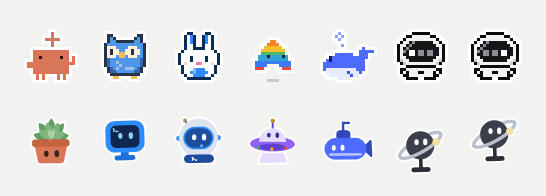
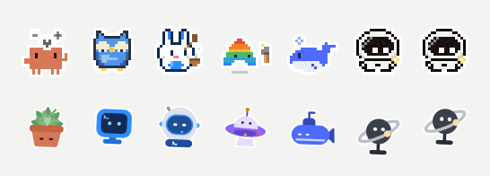

<div align="center">

# Edgelings

**Little bots at the edge of your screen that keep an eye on your AI coding agents.**

One bot per agent. It shows what the agent is doing, says so when it needs you, and keeps its quotas and token use in view. Local-first: no account, no telemetry.

[简体中文](README.zh-CN.md)

</div>

Edgelings grew out of [Agent Island](https://github.com/PurryTam/agent-island) by Tristan Tang (MIT). The Windows app is the main thing here. The macOS app is still Agent Island as it was, see [macOS](#macos).

<p align="center">
  
</p>

<table>
  <tr>
    <td align="center"><br><sub>Thinking</sub></td>
    <td align="center"><br><sub>Working</sub></td>
  </tr>
</table>

## What it does on Windows

A WinUI 3 app. It sits as a thin drawer of bots on the left or right edge of a display, plus a tray icon.

- **Agents.** Claude Code and Claude Desktop, Codex, Kimi Code, Antigravity, Cursor, Grok (the CLI) and Grok Bot, and DeepSeek Harness. Cursor shares Grok's bot. Grok Bot only counts as present or not: it reports no task state. You can reorder agents in Settings, and hide them there or from the drawer's right-click menu.
- **Phases.** A bot acts out what its agent is doing: thinking, reading, searching, writing, running a command, controlling the computer, waiting on sub-agents, asking a question, waiting for your approval, finished, failed, a network problem, out of quota, or needing a sign-in. A bot rests when its agent's app is closed.
- **Two styles.** Pixel (small pixel-art animals and objects) and Classic (soft vector stickers). Each agent has several looks to pick from in each style.
- **Bubbles.** When a session needs you, its bot says one short stock line: it finished, it needs approval, it has a question, it hit an error, or Kimi mail arrived. A bubble never shows a session's name or anything the agent wrote. Sessions of one agent speak one at a time and merge into "N sessions need you" when several wait. Bubbles can be switched off.
- **Hover card.** Hover a bot to see its phase, how many tasks are running, its quota windows, its token use, and the sessions waiting on you, each with a one-word reason (Approval, Question, Error, Done, Mail). Left-clicking the tray icon shows every agent in one card for a few seconds.
- **Quotas.** Claude and Codex: the 5-hour and weekly windows. Antigravity: 5-hour, weekly and its Gemini pools. Kimi Code: 5-hour, weekly and monthly. Grok: its weekly pool and monthly budget. Cursor: the 30-day billing period. DeepSeek Harness has no quota, only token counts. Each bar can read as used or as remaining.
- **Usage & cost.** A page in Settings for today, this week and this month, from the agents' local logs: tokens, an estimated cost at API list prices (an estimate, not a bill), and the busiest agent. Grok's dollars are the figure its CLI records; Cursor bills by plan, so it has tokens only. Kimi Code lists the models of other providers you connect to it, priced by their own price lists, and shows the memory plugin's background runs as their own "Memory (background)" row.
- **Kimi mail.** Unread messages from the Kimi Code mailbox plugin show as a "Mail" row on the card (with the count) and as one stock bubble when new mail arrives. Only the number of unread files is counted; messages are never read.
- **Settings and tray.** Style and look, edge and display, lock or centre the drawer, frame rate and a battery-saving mode, refresh interval (5, 15 or 30 minutes), launch at login, and the language (follow Windows, English or Simplified Chinese). The tray menu shows the drawer, opens each agent's settings, and its tooltip lists the quota use.

<table>
  <tr>
    <td align="center"><br><sub>Pixel hover card</sub></td>
    <td align="center"><br><sub>Classic hover card</sub></td>
  </tr>
</table>

<p align="center">
  <br>
  <sub>Stock bubbles</sub>
</p>

<p align="center">
  <br>
  <sub>The all-agents card</sub>
</p>

The pictures are rendered offscreen by the app's own preview tools from made-up data; the bots are the drawer's own. They show no real sessions.

### What it doesn't do

- It doesn't approve anything and doesn't type into an agent. It only shows that a session waits for you.
- It doesn't resume or open sessions.
- It has no auto-update on Windows.

## Get it

There are no releases of Edgelings yet. Build it from source (Windows 10 version 1809 or later, x64; the .NET 10 SDK):

```powershell
dotnet build windows/src/AgentIsland.WinUI/AgentIsland.WinUI.csproj -c Release -p:Platform=x64
dotnet run --project windows/tests/AgentIsland.Tests -c Release
.\windows\build.ps1
```

The last command publishes a self-contained build and zips it as `windows\dist\Edgelings-<version>-win-x64.zip`. Unzip it and run `Edgelings.exe`.

Every push that changes the Windows code also builds a test package in GitHub Actions, and the workflow can be run by hand from the Actions tab: open the run and download `Edgelings-win-x64-test` under Artifacts (you need to be signed in to GitHub). The Windows builds are not code-signed.

The app's own name is still "Agent Island" for now. Its code lives under `windows/`: `AgentIsland.Core` holds everything below the UI (scanning, usage, cost) and `AgentIsland.WinUI` the app. [windows/README.md](windows/README.md) has the layout and [docs/windows-drawer-themes.md](docs/windows-drawer-themes.md) the design notes for the drawer.

## Privacy

Edgelings runs on your PC and has no account, analytics, crash upload or update check of its own.

**What it reads, locally:** each agent's session logs and settings, to tell what it is doing. That is `~/.claude` (and Claude Desktop's session folders), `~/.codex`, `~/.kimi-code` (including the mailbox folder, where it only lists file names), `~/.gemini` for Antigravity, `~/.grok`, `~/.dsh` for DeepSeek Harness, and Cursor's `state.vscdb` (opened read-only). Costs are worked out from these logs. A crash log is written to `%APPDATA%\AgentIsland`.

**What it sends, and with whose credentials:** only quota and plan requests (and token refreshes) to each agent's own service, using the sign-in the agent already stored on your PC:

| Agent | Server | Sign-in used |
|---|---|---|
| Claude | `api.anthropic.com`, token refresh at `platform.claude.com` | the Claude Code sign-in (`CLAUDE_CODE_OAUTH_TOKEN` or `~/.claude/.credentials.json`) |
| Codex | `chatgpt.com` | `~/.codex/auth.json` |
| Grok | `cli-chat-proxy.grok.com`, token refresh at `auth.x.ai` | `~/.grok/auth.json` |
| Cursor | `api2.cursor.sh` | the token in Cursor's own database |
| Kimi Code | `api.kimi.com` | `~/.kimi-code/credentials/kimi-code.json` (never refreshed by Edgelings) |

Kimi Code's desktop app server and Antigravity's language server are asked over loopback (`127.0.0.1`) only. Nothing is uploaded anywhere else.

**What it writes outside its own folders:**

- When a Claude or Grok token is refreshed, the new token is written back to that agent's own sign-in file.
- Switching Codex accounts, or the opt-in auto-switch, writes `~/.codex/auth.json`.
- Two optional switches, both off by default, install an observe-only hook so Edgelings can tell a permission prompt is open: a Notification hook in `~/.claude/settings.json` (the first change keeps a `.agentisland.bak` copy) and a hook file under `~/.grok/hooks`. A hook has no say over permissions.
- Launch at login, if you turn it on, adds a `Run` entry for the current user.

## macOS

`Sources/` is Agent Island 2.1.2 as upstream shipped it, plus a few small fixes. None of the Windows features above (the drawer, the characters, the per-session bubbles, the Kimi, DeepSeek and Grok Bot support, the Usage & cost page) are in the macOS app yet. A port is planned.

Every push that changes the macOS code builds an unsigned test package, `AgentIsland-macos-test`, under the run's Artifacts (this workflow can be run by hand too). Because it is not signed, the first launch needs a right-click and **Open**. To build it yourself on a Mac, run `./scripts/verify.sh`, which runs the unit suites, builds and smoke-launches `build/AgentIsland.app`. A source build has the update feed switched off unless you set `SU_FEED_URL`.

Upstream's notes on how it works are still in [docs/how-agent-island-detects-session-state.md](docs/how-agent-island-detects-session-state.md). CONTRIBUTING, SECURITY, ROADMAP, CHANGELOG and the other docs here still speak for Agent Island.

## License

MIT. The original copyright, Tristan Tang's, stays in [LICENSE](LICENSE).
