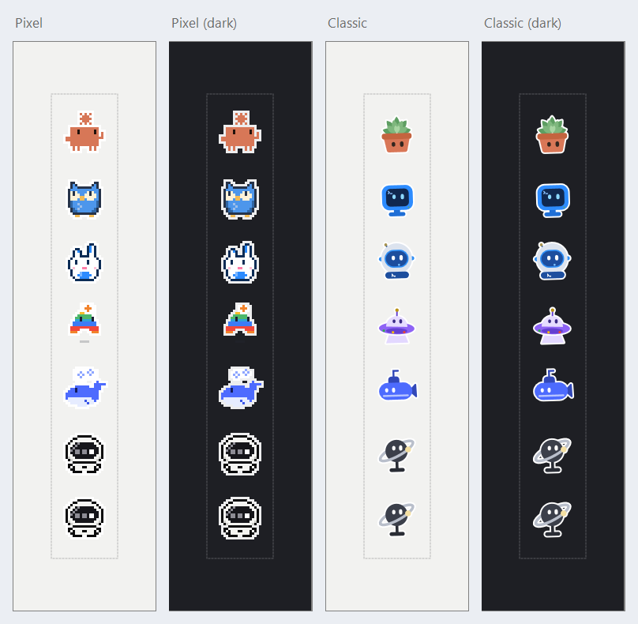
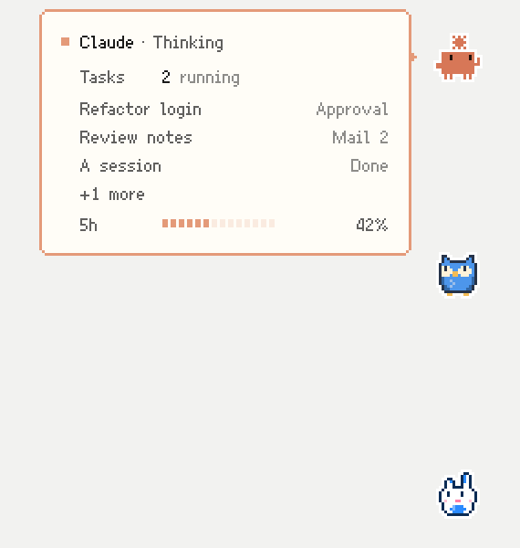
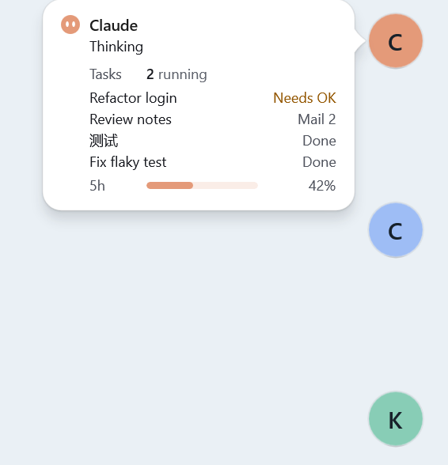
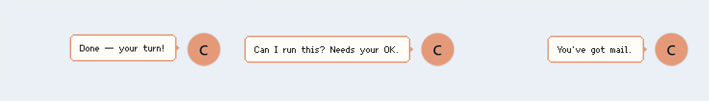
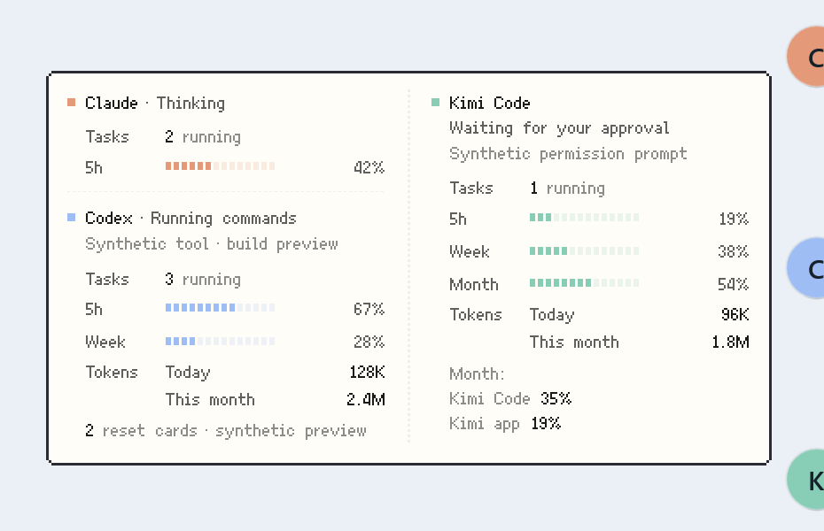

<div align="center">

# Edgelings

**住在屏幕边缘的小机器人,替你盯着 AI 编程 Agent。**

每个 Agent 一个小机器人:它在做什么,它什么时候需要你,额度和 Token 用了多少,一眼都能看到。本地优先,无需账号,无遥测。

[English](README.md)

</div>

Edgelings 源自 Tristan Tang 的 [Agent Island](https://github.com/PurryTam/agent-island)(MIT)。这里的重点是 Windows 版;macOS 版仍是原来的 Agent Island,见 [macOS](#macos)。

<p align="center">
  
</p>

## Windows 版能做什么

基于 WinUI 3。屏幕左边缘或右边缘有一排小机器人组成的抽屉,另有托盘图标。

- **支持的 Agent。** Claude Code 和 Claude Desktop、Codex、Kimi Code、Antigravity、Cursor、Grok(命令行)和 Grok Bot、DeepSeek Harness。Cursor 与 Grok 共用一个机器人。Grok Bot 只判断它开着没有,不报告任务状态。你可以在设置里调整 Agent 的顺序,也可以在设置或抽屉的右键菜单里隐藏它们。
- **状态。** 机器人会演出 Agent 正在做的事:思考、阅读、搜索、写文件、运行命令、操作电脑、等待子 Agent、提问、等你批准、已完成、出错、网络问题、额度用完、需要重新登录。Agent 的应用关闭时,它的机器人会休息。
- **两种风格。** Pixel(像素风的小动物和小物件)和 Classic(柔和的矢量贴纸)。每种风格里,每个 Agent 都有几个造型可选。
- **气泡。** 某个会话需要你时,它的机器人会说一句固定的短话:完成了、需要批准、有问题要问、出错了,或者 Kimi 来了邮件。气泡里不会出现会话名,也不会出现 Agent 写的任何内容。同一个 Agent 的多个会话轮流说话,同时有好几个在等你时合并成"N 个会话需要你"。气泡可以关掉。
- **悬停卡片。** 鼠标移到机器人上,可以看到它的状态、正在运行的任务数、额度窗口、Token 用量,以及正在等你的会话,每个会话配一个词说明原因(批准、提问、出错、完成、邮件)。左键点托盘图标,会把所有 Agent 合在一张卡片里显示几秒钟。
- **额度。** Claude 和 Codex:5 小时窗口和每周窗口。Antigravity:5 小时、每周,以及 Gemini 的额度池。Kimi Code:5 小时、每周、每月。Grok:每周额度池和月预算。Cursor:30 天计费周期。DeepSeek Harness 没有额度,只有 Token 计数。每个进度条可以显示"已用"或"剩余"。
- **用量与费用。** 设置里的一个页面,按今天、本周、本月统计,数据来自各 Agent 的本地日志:Token 数、按 API 标价估算的费用(只是估算,不是账单)、最忙的 Agent。Grok 的美元数是它的命令行自己记录的数;Cursor 按套餐计费,所以只显示 Token。Kimi Code 会把你接入它的其他服务商的模型单独列出,按各自的价格表计价;记忆插件在后台跑的任务则单独显示为"记忆(后台)"一行。
- **Kimi 邮件。** Kimi Code 的邮箱插件里的未读消息,会在卡片上显示成"邮件"一行(带数量),新邮件到达时机器人说一句固定的话。只数未读文件的个数,从不读取消息内容。
- **设置与托盘。** 风格和造型、停靠的边和显示器、锁定或居中抽屉、帧率和省电模式、刷新间隔(5、15 或 30 分钟)、开机启动、界面语言(跟随 Windows、English、简体中文)。托盘菜单可以显示抽屉、直达各 Agent 的设置,悬停提示里列出各 Agent 的额度使用情况。

<table>
  <tr>
    <td align="center"><br><sub>Pixel 悬停卡片</sub></td>
    <td align="center"><br><sub>Classic 悬停卡片</sub></td>
  </tr>
</table>

<p align="center">
  <br>
  <sub>固定话术的气泡(Pixel 风格下说英文)</sub>
</p>

<p align="center">
  <br>
  <sub>全部 Agent 合在一张卡片里</sub>
</p>

这些图都是应用自带的预览工具用虚构数据离屏渲染的,图里的小机器人是抽屉里真正的角色,不含任何真实会话。

### 它不做什么

- 不替你批准任何操作,也不往 Agent 里输入内容,只是告诉你有会话在等你。
- 不恢复、不打开会话。
- Windows 版没有自动更新。

## 获取

Edgelings 目前还没有发布版本。请从源码构建(Windows 10 1809 或更新版本,x64;需要 .NET 10 SDK):

```powershell
dotnet build windows/src/AgentIsland.WinUI/AgentIsland.WinUI.csproj -c Release -p:Platform=x64
dotnet run --project windows/tests/AgentIsland.Tests -c Release
.\windows\build.ps1
```

最后一条命令发布一个自包含的版本,并打成 `windows\dist\AgentIsland-<version>-win-x64.zip`。解压后运行 `AgentIsland.WinUI.exe`。

每次推送也会在 GitHub Actions 里构建一个测试包:打开对应的运行记录,在 Artifacts 下下载 `AgentIsland-win-x64-test`(需要登录 GitHub)。Windows 版没有代码签名。

应用本身目前仍叫 Agent Island。代码在 `windows/` 下:`AgentIsland.Core` 是界面以下的全部逻辑(扫描、用量、费用),`AgentIsland.WinUI` 是应用本体。目录说明见 [windows/README.md](windows/README.md),抽屉的设计笔记见 [docs/windows-drawer-themes.md](docs/windows-drawer-themes.md)。

## 隐私

Edgelings 在你自己的电脑上运行,自己没有账号、统计分析、崩溃上传或更新检查。

**本地读取什么:** 各个 Agent 的会话日志和设置,用来判断它在做什么。也就是 `~/.claude`(以及 Claude Desktop 的会话目录)、`~/.codex`、`~/.kimi-code`(包括邮箱目录,只列出文件名)、Antigravity 的 `~/.gemini`、`~/.grok`、DeepSeek Harness 的 `~/.dsh`,以及 Cursor 的 `state.vscdb`(只读打开)。费用就是从这些日志算出来的。崩溃日志写在 `%APPDATA%\AgentIsland`。

**往外发什么、用谁的凭据:** 只向各个 Agent 自己的服务发额度和套餐查询(以及 Token 刷新),用的是 Agent 已经存在你电脑上的登录信息:

| Agent | 服务器 | 使用的登录信息 |
|---|---|---|
| Claude | `api.anthropic.com`,Token 刷新走 `platform.claude.com` | Claude Code 的登录(`CLAUDE_CODE_OAUTH_TOKEN` 或 `~/.claude/.credentials.json`) |
| Codex | `chatgpt.com` | `~/.codex/auth.json` |
| Grok | `cli-chat-proxy.grok.com`,Token 刷新走 `auth.x.ai` | `~/.grok/auth.json` |
| Cursor | `api2.cursor.sh` | Cursor 自己数据库里的 Token |
| Kimi Code | `api.kimi.com` | `~/.kimi-code/credentials/kimi-code.json`(Edgelings 从不刷新它) |

Kimi Code 桌面端的服务和 Antigravity 的语言服务只通过本机回环地址(`127.0.0.1`)访问。除此之外不会上传到任何地方。

**在自己的目录以外会写什么:**

- 刷新 Claude 或 Grok 的 Token 后,新 Token 会写回那个 Agent 自己的登录文件。
- 切换 Codex 账号,或打开可选的自动切换时,会写 `~/.codex/auth.json`。
- 两个可选开关(默认都关闭)会安装只观察、不干预的 hook,让 Edgelings 知道某个权限提示正开着:`~/.claude/settings.json` 里的 Notification hook(第一次修改会留一份 `.agentisland.bak` 备份),以及 `~/.grok/hooks` 下的一个 hook 文件。hook 对权限没有决定权。
- 如果你打开"开机启动",会为当前用户加一条 `Run` 启动项。

## macOS

`Sources/` 是上游发布的 Agent Island 2.1.2,外加少量小修复。上面这些 Windows 功能(抽屉、角色、按会话的气泡、对 Kimi、DeepSeek、Grok Bot 的支持、用量与费用页)macOS 版还都没有,计划之后移植。

每次推送也会构建一个未签名的测试包 `AgentIsland-macos-test`,在对应运行记录的 Artifacts 下。因为没有签名,第一次打开需要右键并选择"打开"。想在 Mac 上自己构建,运行 `./scripts/verify.sh`:它会跑单元测试、构建,并冒烟启动 `build/AgentIsland.app`。源码构建默认关闭更新源,除非你设置了 `SU_FEED_URL`。

上游关于工作原理的说明仍在 [docs/how-agent-island-detects-session-state.md](docs/how-agent-island-detects-session-state.md)。CONTRIBUTING、SECURITY、ROADMAP、CHANGELOG 和这里的其他文档仍然是 Agent Island 的内容。

## 许可证

MIT。原作者 Tristan Tang 的版权声明保留在 [LICENSE](LICENSE) 里。
